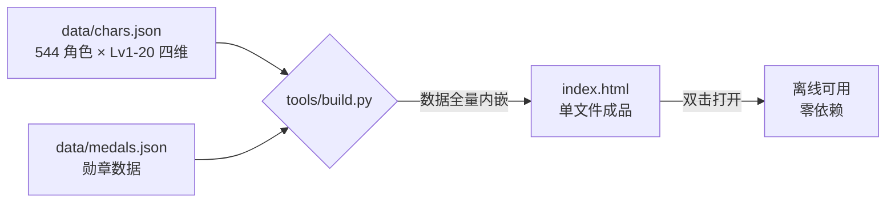

<div align="center">

# 百分之一 · 作战效能计算器

**《百分之一》实战战力计算器** —— 单文件 HTML，纯前端、零依赖、离线可用

每名角色的全部等级四维**已内置**，双击即算

[](#)
[](#)
[](#)
[](LICENSE)

### 🔗 在线打开（无需下载）

**<https://htbjiangnan.github.io/bfzy-power-calculator/>**

</div>

---

> 角色数据截止 **2026-10-09**，共 **544** 名角色（Lv1–20 四维全量）

## 它解决什么问题

游戏内的「作战效能」由**等级、星级、天赋、勋章、基站、图鉴、公会、奇点排查**等多维加成共同决定，手算既慢又容易错。
这个计算器把公式与全量角色数据打包成一个 HTML 文件，选完参数立刻出结果，还带一个**本体战力排行榜**。

## 功能

| 模块 | 说明 |
|---|---|
| 角色 | 单输入框：点开下拉选择，或输入关键词实时筛选（↑ / ↓ + Enter） |
| 等级 / 星级 | Lv1–20；当前星级 1–6，自动带入角色初始星级，且不可低于初始星 |
| 天赋 | 天赋 1 / 2 / 3，按药剂数量计（1 + 2 + 3） |
| 外部加成 · 勋章 | 3 个槽位，允许重复装备同类；I / II / III 级 |
| 外部加成 · 基站模块 | 攻击 / 护甲 / 生命 / 灵力，下拉选择等级 |
| 外部加成 · 图鉴 | 手动填写四维加成 |
| 固定加成 | 公会、奇点排查（勾选） |
| 双口径 | **队伍界面**（含公会 + 奇点排查 + 勋章） / **设置界面**（仅基站 + 图鉴） |
| 排行榜 | 本体战力 Top10（Lv20 · 6 星 · 天赋全开，不含任何加成），点击条目直接载入 |

## 计算公式

```
战力 = 175
     + (等级 + 生命 + 护甲) × 3
     + 攻击 × 5
     + 灵力 × 10
     + 药剂数量 × 100
     + 初始星级 × 30
     + 当前星级 × 50
     + 外部加成折算
```

外部加成折算 = **攻击 × 5 + 生命 × 3 + 护甲 × 3 + 灵力 × 10**

| 界面口径 | 计入的加成 |
|---|---|
| **队伍界面** | 基站模块 + 图鉴 + 公会 + 奇点排查 + **勋章** |
| **设置界面** | 基站模块 + 图鉴 |

## 数据是怎么进去的



`index.html` 里的角色与勋章数据是**直接写死在文件内**的（不请求任何接口），所以它能离线打开、也能直接挂到静态托管上。

## 快速开始

**方式一：在线直接用（推荐）**

打开 <https://htbjiangnan.github.io/bfzy-power-calculator/> —— 手机、电脑浏览器都能开，不用下载。

**方式二：离线使用**

1. 下载 `index.html`
2. **双击**，用浏览器打开 —— 不需要联网，也不需要服务器

## 在线托管说明

本仓库已启用 **GitHub Pages**（`main` 分支根目录），推送后自动发布：

| 项 | 值 |
|---|---|
| 在线地址 | <https://htbjiangnan.github.io/bfzy-power-calculator/> |
| 构建来源 | `main` 分支根目录的 `index.html` |
| 缓存 | 约 10 分钟（`Cache-Control: max-age=600`），更新后稍等即可看到 |

> Fork 本仓库后，在 `Settings → Pages` 里选 `main` 分支根目录即可得到自己的在线地址。

## 目录结构

```
.
├── index.html        # 成品：数据全量内嵌，直接打开即可使用
├── data/
│   ├── chars.json    # 角色数据源：每角色 Lv1-20 四维 + 初始星级 + 形态
│   └── medals.json   # 勋章数据源
├── tools/
│   └── build.py      # 生成器：读 data/ → 产出 index.html
└── LICENSE
```

`data/chars.json` 结构：

```jsonc
{
  "chars": {
    "角色名": {
      "lv":  { "1": [攻击, 生命, 护甲, 灵力], "2": [ ... ], "...": [] },  // 逐级四维
      "rar": 3,        // 初始星级
      "eth": "火"      // 形态 / 属性
    }
  }
}
```

## 更新数据

1. 编辑 `data/chars.json`（与 `data/medals.json`）
2. 把 `tools/build.py` 里的 `DATA_AS_OF` 改成新的截止日期
3. 重新生成：

```bash
python tools/build.py     # → 重新产出 index.html
```

## 数据来源与免责声明

- 角色与勋章数据由社区自游戏内整理，可能存在滞后或误差，**数值请以游戏内为准**。
- 本项目为**非官方粉丝作品**，仅供学习交流，与游戏开发商 / 发行商无任何关联。
- 游戏名称、角色名称及相关内容版权归原权利方所有。

## License

代码部分以 [MIT](LICENSE) 许可开源。
